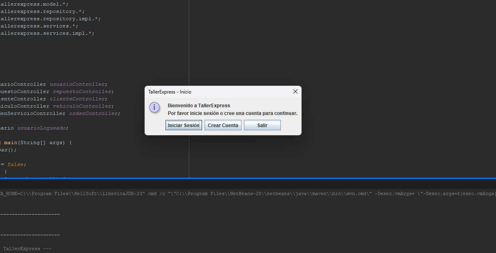
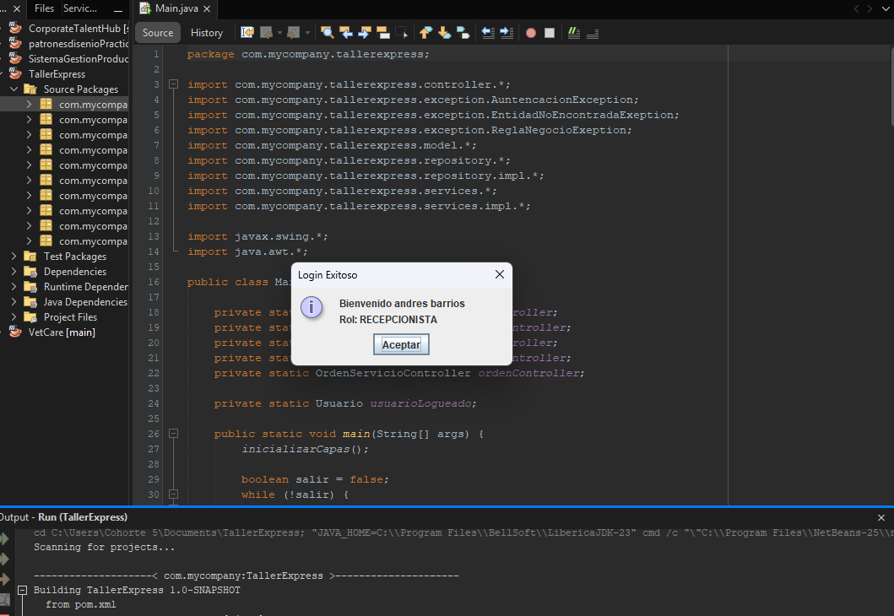
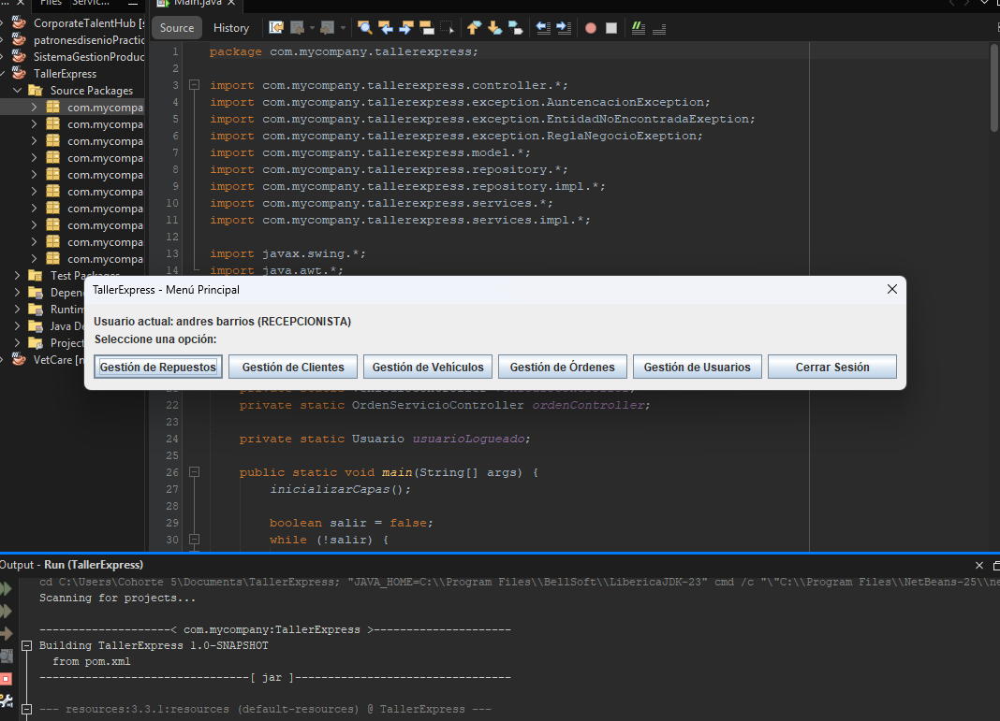
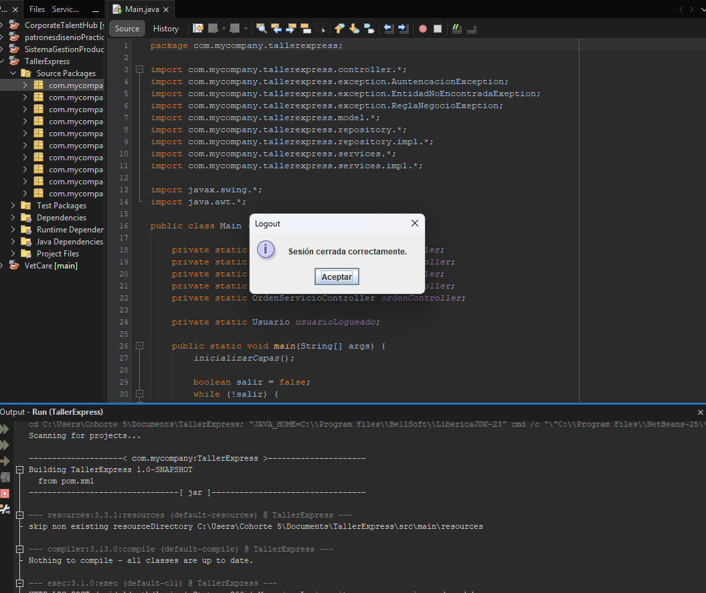
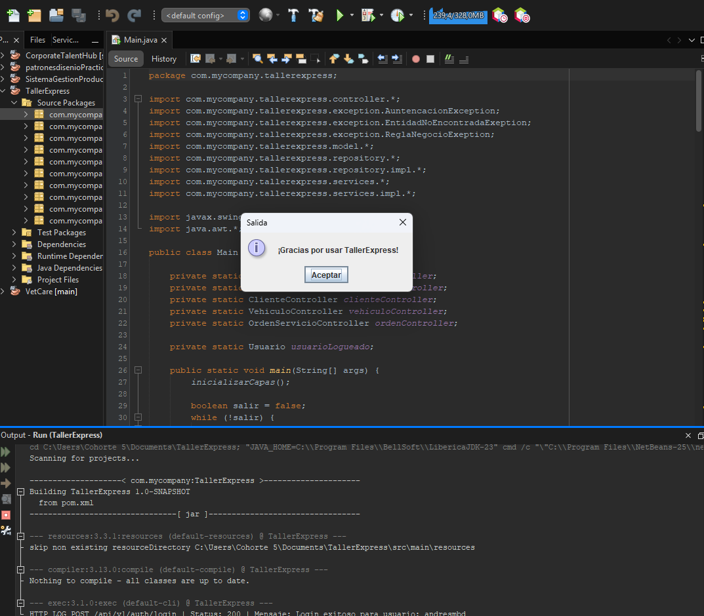
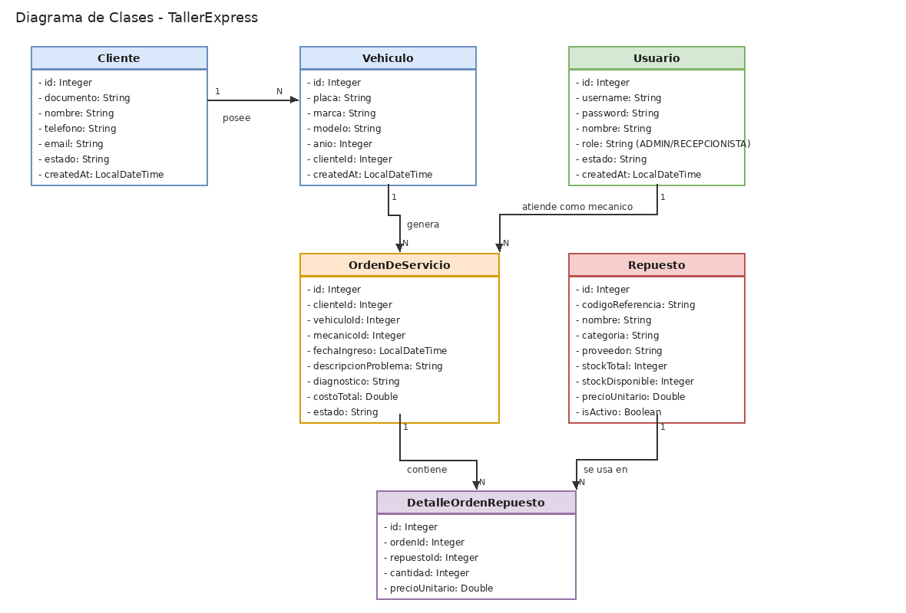
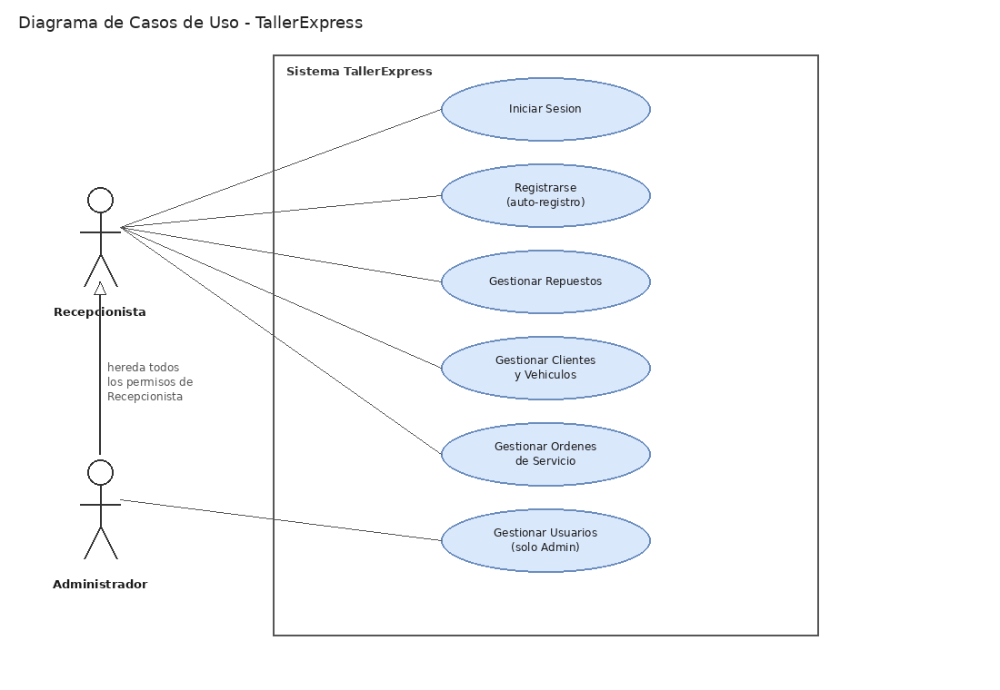

# TallerExpress

## Description
It is an efficient inventory manager for spare parts, customers, vehicles, users, and service orders. Built using Java 17+ following clean software design principles, the application manages multientity operation including Users, Customers, vehicles, service orders and spare parts order details with persistent storage provided by a PostgreSQL database via JDBC.

## Technologies
- **Programming Language:** Java 17+ (project compiled with Java 21)
- **Database:** PostgreSQL 15+
- **Containerization:** Docker & Docker Compose
- **Persistence Layer:** JDBC (Java Database Connectivity) with `PreparedStatement`
- **Database Tooling:** pgAdmin 4
- **Architecture & Design Patterns:** Layered Architecture, Repository Pattern (DAO), Decorator Pattern, Dependency Injection, Data Transfer / Value Mapping
- **Development Environment:** NetBeans IDE / Apache Maven

## Prerequisites
Before running the project, make sure you have installed:

| Tool | Minimum version | Check with |
|---|---|---|
| Java JDK | 17+ (project uses 21) | `java -version` |
| Apache Maven | 3.8+ | `mvn -version` |
| Docker & Docker Compose | any recent version | `docker -version` / `docker compose version` |
| Git | any recent version | `git --version` |

You'll also need a PostgreSQL client to run the `script.sql` file (pgAdmin, DBeaver, or the `psql` CLI that comes bundled with the Docker image itself — no separate install needed for that option).

## Application Structure
```
.
│   docker-compose.yml
│   link.txt
│   nbactions.xml
│   pom.xml
│   README.md
│   script.sql
│
├───assets
│       diagrama_casos_uso_tallerexpress.png
│       diagrama_clases_tallerexpress.png
│       image.png
│       image1.png
│       image2.png
│       image3.png
│       image4.png
│
├───src
│   ├───main
│   │   └───java
│   │       └───com
│   │           └───mycompany
│   │               └───tallerexpress
│   │                   │   Main.java
│   │                   │
│   │                   ├───conexiondb
│   │                   │       ConexionDB.java
│   │                   │
│   │                   ├───controller
│   │                   │       ClienteController.java
│   │                   │       OrdenServicioController.java
│   │                   │       RepuestoController.java
│   │                   │       UsuarioController.java
│   │                   │       VehiculoController.java
│   │                   │
│   │                   ├───exception
│   │                   │       AuntencacionException.java
│   │                   │       EntidadNoEncontradaExeption.java
│   │                   │       ReglaNegocioExeption.java
│   │                   │
│   │                   ├───model
│   │                   │       Cliente.java
│   │                   │       DetalleOrdenRepuesto.java
│   │                   │       OrdernesDeServicio.java
│   │                   │       Repuesto.java
│   │                   │       Usuario.java
│   │                   │       Vehiculo.java
│   │                   │
│   │                   ├───repository
│   │                   │   │   ClienteRepository.java
│   │                   │   │   OrdenesDeServicioRepository.java
│   │                   │   │   RepuestoRepository.java
│   │                   │   │   UsuarioRepository.java
│   │                   │   │   VehiculoRepository.java
│   │                   │   │
│   │                   │   └───impl
│   │                   │           ClienteRepositoryImpl.java
│   │                   │           OrdenesDeServicioRepositoryImpl.java
│   │                   │           RepuestoRepositoryImpl.java
│   │                   │           UsuarioRepositoryImpl.java
│   │                   │           VehiculoRepositoryImpl.java
│   │                   │
│   │                   ├───services
│   │                   │   │   ClienteService.java
│   │                   │   │   OrdenServicioService.java
│   │                   │   │   RepuestoService.java
│   │                   │   │   UsuarioService.java
│   │                   │   │   VehiculoService.java
│   │                   │   │
│   │                   │   └───impl
│   │                   │           ClienteServiceImpl.java
│   │                   │           OrderServicioServiceImpl.java
│   │                   │           RepuestoServiceImpl.java
│   │                   │           UsuarioServiceDecorator.java
│   │                   │           UsuarioServiceImpl.java
│   │                   │           VehiculoServiceImpl.java
│   │                   │
│   │                   └───util
│   │                           LoggerUtil.java
│   │                           TablaHelper.java
│   │
│   └───test
│       └───java
└───target
    │   TallerExpress-1.0-SNAPSHOT.jar
    │
    ├───classes
    │   └───com
    │       └───mycompany
    │           └───tallerexpress
    │               │   Main.class
    │               │
    │               ├───conexiondb
    │               │       ConexionDB.class
    │               │
    │               ├───controller
    │               │       ClienteController.class
    │               │       OrdenServicioController.class
    │               │       RepuestoController.class
    │               │       UsuarioController.class
    │               │       VehiculoController.class
    │               │
    │               ├───exception
    │               │       AuntencacionException.class
    │               │       EntidadNoEncontradaExeption.class
    │               │       ReglaNegocioExeption.class
    │               │
    │               ├───model
    │               │       Cliente.class
    │               │       DetalleOrdenRepuesto.class
    │               │       OrdernesDeServicio.class
    │               │       Repuesto.class
    │               │       Usuario.class
    │               │       Vehiculo.class
    │               │
    │               ├───repository
    │               │   │   ClienteRepository.class
    │               │   │   OrdenesDeServicioRepository.class
    │               │   │   RepuestoRepository.class
    │               │   │   UsuarioRepository.class
    │               │   │   VehiculoRepository.class
    │               │   │
    │               │   └───impl
    │               │           ClienteRepositoryImpl.class
    │               │           OrdenesDeServicioRepositoryImpl.class
    │               │           RepuestoRepositoryImpl.class
    │               │           UsuarioRepositoryImpl.class
    │               │           VehiculoRepositoryImpl.class
    │               │
    │               ├───services
    │               │   │   ClienteService.class
    │               │   │   OrdenServicioService.class
    │               │   │   RepuestoService.class
    │               │   │   UsuarioService.class
    │               │   │   VehiculoService.class
    │               │   │
    │               │   └───impl
    │               │           ClienteServiceImpl.class
    │               │           OrderServicioServiceImpl.class
    │               │           RepuestoServiceImpl.class
    │               │           UsuarioServiceDecorator.class
    │               │           UsuarioServiceImpl.class
    │               │           VehiculoServiceImpl.class
    │               │
    │               └───util
    │                       LoggerUtil.class
    │                       TablaHelper.class
    │
    ├───generated-sources
    │   └───annotations
    ├───generated-test-sources
    │   └───test-annotations
    ├───maven-archiver
    │       pom.properties
    │
    ├───maven-status
    │   └───maven-compiler-plugin
    │       ├───compile
    │       │   └───default-compile
    │       │           createdFiles.lst
    │       │           inputFiles.lst
    │       │
    │       └───testCompile
    │           └───default-testCompile
    │                   createdFiles.lst
    │                   inputFiles.lst
    │
    └───test-classes
```

## Database Configuration

The `docker-compose.yml` only starts an **empty** PostgreSQL container — it does **not** create the tables automatically. You need to run `script.sql` yourself, once, right after the container is up.

**1 — Start the PostgreSQL container:**
```bash
docker compose up -d
```
This creates a container named `taller-express-container`, exposing PostgreSQL on port `5434`, with:
- Database: `tallerexpress_db`
- User: `postgres`
- Password: `postgres`

**2 — Verify the container is running:**
```bash
docker ps
```
You should see `taller-express-container` with status `Up`.

**Step 3 — Create the tables by running `script.sql`.** You have two options:

*Option A — from the terminal (fastest), piping the script into the container:*
```bash
docker exec -i taller-express-container psql -U postgres -d tallerexpress_db < script.sql
```

*Option B — using a GUI client (pgAdmin, DBeaver, etc.):*
1. Create a new connection with host `localhost`, port `5434`, database `tallerexpress_db`, user `postgres`, password `postgres`.
2. Open `script.sql` and execute its full content against that connection.


> Note: passwords are stored as plain text in this version of the project (no hashing yet), so keep this in mind — it's fine for this academic exercise, but never do this in a real production system.

## Users & Roles
The system supports two roles: `ADMIN` and `RECEPCIONISTA`.

- Signing up from the login screen ("Registrarse"), active status and creation date are filled in automatically by a decorator (`UsuarioServiceDecorator`), The user can self-assign a role.

- Only an already-logged-in `ADMIN` can create other users with a chosen role, from the internal "Gestión de Usuarios" menu.

- Both roles can access Repuestos, Clientes, Vehículos and Órdenes de Servicio. Only `ADMIN` can access Gestión de Usuarios.

## Execution Instructions

1. Clone this repository:
```bash
git clone https://github.com/andresmbd/prueba-desempeno-java.git
```
2. Follow the **Database Configuration** steps above (start the container, run `script.sql`, create the first admin user).
3. Run the application, either:

   **Option A — from NetBeans IDE (recommended):**
   Open the project, locate `Main.java` and run it (`Shift + F6`).

   **Option B — from the command line, with Maven:**
   ```bash
   mvn compile
   mvn org.codehaus.mojo:exec-maven-plugin:3.1.0:exec
   ```

4. Log in with the admin user you created, or use "Registrarse" to create a new `RECEPCIONISTA` or `ADMIN` account.

## Visual Interface







## Class Diagram


## Use Case Diagram


## Coder Information
Name: Andres Barrios

Clan: Puerta De Oro

Program: Riwi.io

Email: anmabadi@outlook.com
