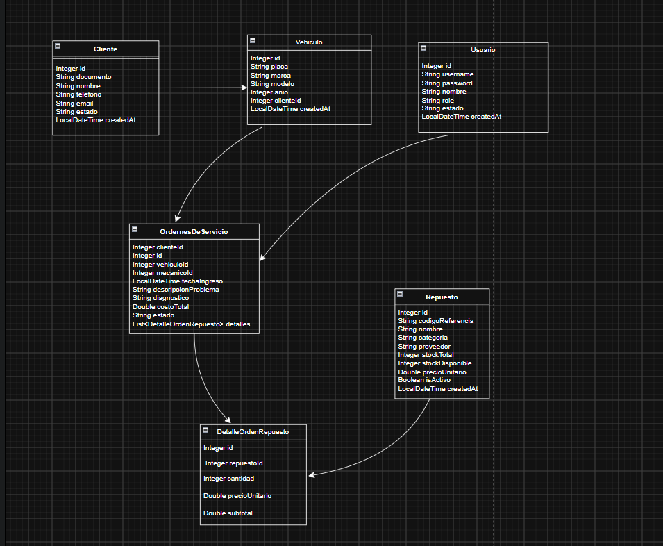

# TallerExpress 

## Description 
It is an efficient inventory manager for spare parts, customers, vehicles, users, and service orders. Built using Java 17+ following clean software design principles, the application manages multientity operation including Users, Customers, vehicles, service orders and and spare parts order details with persistent storage provided by a PostgreSQL database via JDBC.

## Technologies
- **Programming Language:** Java 17+ 
- **Database:** PostgreSQL 15+
- **Containerization:** Docker & Docker Compose
- **Persistence Layer:** JDBC (Java Database Connectivity) with `PreparedStatement`
- **Database Tooling:** pgAdmin 4
- **Architecture & Design Patterns:** Layered Architecture, Repository Pattern (DAO), Dependency Injection, Data Transfer / Value Mapping
- **Development Environment:** NetBeans IDE / Apache Maven

## Application Structure
```
.
│   docker-compose.yml
│   nbactions.xml
│   pom.xml
│   README.md
│   script.sql
│
├───assets
│       image.png
│       image1.png
│       image2.png
│       image3.png
│       image4.png
│
├───src
│   ├───main
│   │   └───java
│   │       └───com
│   │           └───mycompany
│   │               └───tallerexpress
│   │                   │   Main.java
│   │                   │
│   │                   ├───conexiondb
│   │                   │       ConexionDB.java
│   │                   │
│   │                   ├───controller
│   │                   │       ClienteController.java
│   │                   │       OrdenServicioController.java
│   │                   │       RepuestoController.java
│   │                   │       UsuarioController.java
│   │                   │       VehiculoController.java
│   │                   │
│   │                   ├───exception
│   │                   │       AuntencacionException.java
│   │                   │       EntidadNoEncontradaExeption.java
│   │                   │       ReglaNegocioExeption.java
│   │                   │
│   │                   ├───model
│   │                   │       Cliente.java
│   │                   │       DetalleOrdenRepuesto.java
│   │                   │       OrdernesDeServicio.java
│   │                   │       Repuesto.java
│   │                   │       Usuario.java
│   │                   │       Vehiculo.java
│   │                   │
│   │                   ├───repository
│   │                   │   │   ClienteRepository.java
│   │                   │   │   OrdenesDeServicioRepository.java
│   │                   │   │   RepuestoRepository.java
│   │                   │   │   UsuarioRepository.java
│   │                   │   │   VehiculoRepository.java
│   │                   │   │
│   │                   │   └───impl
│   │                   │           ClienteRepositoryImpl.java
│   │                   │           OrdenesDeServicioRepositoryImpl.java
│   │                   │           RepuestoRepositoryImpl.java
│   │                   │           UsuarioRepositoryImpl.java
│   │                   │           VehiculoRepositoryImpl.java
│   │                   │
│   │                   ├───services
│   │                   │   │   ClienteService.java
│   │                   │   │   OrdenServicioService.java
│   │                   │   │   RepuestoService.java
│   │                   │   │   UsuarioService.java
│   │                   │   │   VehiculoService.java
│   │                   │   │
│   │                   │   └───impl
│   │                   │           ClienteServiceImpl.java
│   │                   │           OrderServicioServiceImpl.java
│   │                   │           RepuestoServiceImpl.java
│   │                   │           UsuarioServiceDecorator.java
│   │                   │           UsuarioServiceImpl.java
│   │                   │           VehiculoServiceImpl.java
│   │                   │
│   │                   └───util
│   │                           LoggerUtil.java
│   │                           TablaHelper.java
│   │
│   └───test
│       └───java
└───target
    ├───classes
    │   └───com
    │       └───mycompany
    │           └───tallerexpress
    │               │   Main.class
    │               │
    │               ├───conexiondb
    │               │       ConexionDB.class
    │               │
    │               ├───controller
    │               │       ClienteController.class
    │               │       OrdenServicioController.class
    │               │       RepuestoController.class
    │               │       UsuarioController.class
    │               │       VehiculoController.class
    │               │
    │               ├───exception
    │               │       AuntencacionException.class
    │               │       EntidadNoEncontradaExeption.class
    │               │       ReglaNegocioExeption.class
    │               │
    │               ├───model
    │               │       Cliente.class
    │               │       DetalleOrdenRepuesto.class
    │               │       OrdernesDeServicio.class
    │               │       Repuesto.class
    │               │       Usuario.class
    │               │       Vehiculo.class
    │               │
    │               ├───repository
    │               │   │   ClienteRepository.class
    │               │   │   OrdenesDeServicioRepository.class
    │               │   │   RepuestoRepository.class
    │               │   │   UsuarioRepository.class
    │               │   │   VehiculoRepository.class
    │               │   │
    │               │   └───impl
    │               │           ClienteRepositoryImpl.class
    │               │           OrdenesDeServicioRepositoryImpl.class
    │               │           RepuestoRepositoryImpl.class
    │               │           UsuarioRepositoryImpl.class
    │               │           VehiculoRepositoryImpl.class
    │               │
    │               ├───services
    │               │   │   ClienteService.class
    │               │   │   OrdenServicioService.class
    │               │   │   RepuestoService.class
    │               │   │   UsuarioService.class
    │               │   │   VehiculoService.class
    │               │   │
    │               │   └───impl
    │               │           ClienteServiceImpl.class
    │               │           OrderServicioServiceImpl.class
    │               │           RepuestoServiceImpl.class
    │               │           UsuarioServiceDecorator.class
    │               │           UsuarioServiceImpl.class
    │               │           VehiculoServiceImpl.class
    │               │
    │               └───util
    │                       LoggerUtil.class
    │                       TablaHelper.class
    │
    ├───generated-sources
    │   └───annotations
    └───maven-status
        └───maven-compiler-plugin
            └───compile
                └───default-compile
                        createdFiles.lst
                        inputFiles.lst
```
## Database Configuration
1. Ensure Docker and Docker Compose are installed and running.
2. In the project root directory, run:
~~~bash
docker compose up -d
~~~
3. This command starts a PostgreSQL database container and automatically applies the initial DDL schema.

## Execution Instructions

1. Clone this repository:
~~~bash
git clone https://github.com/andresmbd/prueba-desempeno-java.git
~~~
2. Open the project in NetBeans IDE or your preferred Java IDE.
3. Run the database container as described in the Database Configuration section.
4. Locate Main.java and execute the class (Shift + F6 in NetBeans).

## visual interface

  
  
  
  
  

## Class diagram
  

## Coder Infomation
- Name: Andres Barrios

- clan : Puerta De Oro

- Program: Riwi.io

- Correo: anmabadi@outlook.com